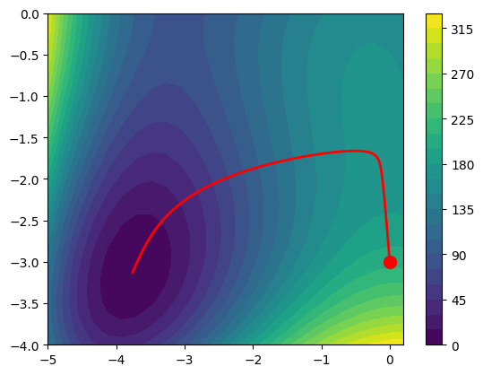

# Gradient descent and support vector machines

The notebook approximates gradients with forward differences, plots descent paths, and fits a linear SVM to simulated two-dimensional points. NumPy handles the arrays; Matplotlib draws the contours and decision boundaries.

The SVM loss combines squared weight regularisation with hinge loss. SciPy's `minimize` fits the bias and weights; this is not a custom optimisation solver.



## Open the notebook

From the repository root:

```sh
python3 -m venv .venv
source .venv/bin/activate
python -m pip install -r requirements.txt
jupyter notebook notebook.ipynb
```

Run cells in order. Package versions and random seeds were not saved. The descent loop updates x before computing the y step, so it differs from a simultaneous gradient update. The final stored SVM output reports `success: False` with a precision-loss warning. Its plot uses the fitting data; there is no held-out accuracy result.

The notebook has not been rerun in this review environment because SciPy is unavailable. The images are recorded outputs, not fresh verification. [The SVM plot](images/svm.png) is included separately.
