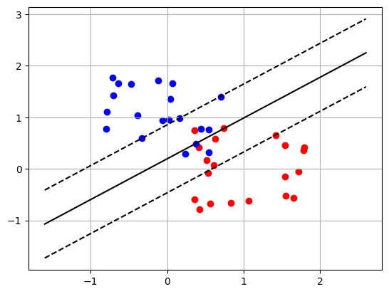

# Gradient descent and support vector machines

Gradient descent and a support vector machine, written from scratch in Python.

## What it does

- Finds minima of functions of two variables with gradient descent, using a finite-difference gradient.
- Plots the descent path on a contour plot.
- Trains a support vector machine on simulated 2D data by minimising a hinge loss with `scipy.optimize.minimize`.




Skills shown: Python, NumPy, Matplotlib, SciPy, optimisation, machine learning fundamentals.

## Run it

```
pip install -r requirements.txt
jupyter notebook notebook.ipynb
```

This was a group project for MATH0011 at UCL.
